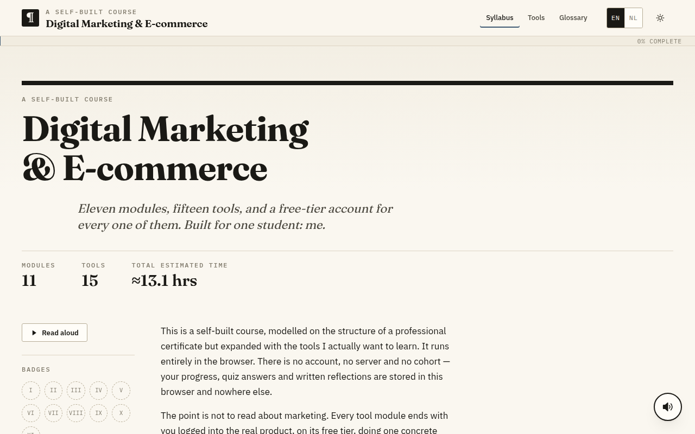

# 📈 Digital Marketing & E-commerce

**A free, self-paced course that teaches digital marketing by doing it: 11 modules, 15 real tools, all in your browser.**

### 🌐 [Open the live course → digital-marketing-ten-snowy.vercel.app](https://digital-marketing-ten-snowy.vercel.app)

[](https://digital-marketing-ten-snowy.vercel.app)

---

## 🤔 What is this?

This is a **self-built course** in digital marketing and online selling. It follows the structure of a professional marketing certificate, then adds the tools you actually use at work.

The idea is simple: **you don't just read about marketing, you practise it.** Every tool module ends with you logged into the real product, on its **free plan**, doing one concrete task.

- 💸 **Free.** Every tool in the course has a free tier.
- 🙈 **No account, no server, no sign-up.** Your progress, quiz answers and notes are saved **in your own browser** and nowhere else.
- 🇬🇧 🇳🇱 **English and Dutch.** Switch language at any time with the **EN / NL** button.
- ⏱️ **About 13 hours** in total, at your own pace.

## ✨ Features

| | Feature | What it does for you |
|---|---|---|
| 📚 | **11 modules** | A clear path from the basics to growing a store |
| 🧰 | **15 real tools** | Hands-on practice with the tools companies use |
| 📝 | **Quizzes** | Check what you learned at the end of a module |
| 🏅 | **Badges** | Earn a badge (I–XI) for every module you finish |
| 📊 | **Progress bar** | See at a glance how far you are ("0% complete" → "100%") |
| 📖 | **Glossary** | 50+ marketing terms explained in plain words |
| 🔊 | **Read aloud** | Let the page be read to you, in English or Dutch, at your own speed |
| 🌗 | **Light and dark mode** | Easy on the eyes, day or night |
| 📱 | **Works on any device** | Phone, tablet or laptop |

## 🗺️ The 11 modules

1. 🧭 **Map the Ground You're Standing On**: how digital marketing fits together
2. 🔎 **Get Found**: search engines, SEO and local listings
3. ✉️ **Write Email People Open**: email marketing that gets read
4. 🎨 **Design It Yourself**: simple, good-looking designs without a designer
5. 📣 **Run Your Social Presence**: plan and schedule social media
6. 🛒 **Open the Shop**: set up an online store
7. 📈 **Read the Numbers**: analytics, so you know what works
8. 🤝 **Keep the Customers You Win**: loyalty and customer relationships
9. ✍️ **Write Words That Work**: copywriting that sells
10. 🗓️ **Plan Content That Lasts**: a content plan you can keep up
11. 🌟 **Borrow Someone Else's Audience**: influencer and partner marketing

## 🧰 The tools you'll use

Google Search Console · Semrush · Ahrefs · Google Ads · Google Business Profile · Mailchimp · Constant Contact · Klaviyo · Canva · Hootsuite · HubSpot · Shopify · Wix · Google Analytics 4 · X (Twitter)

## 🚀 How to use it (no install needed)

1. Open the **[live course](https://digital-marketing-ten-snowy.vercel.app)**.
2. Pick **EN** or **NL** in the top right.
3. Start with **module I** in the **Syllabus**.
4. Read, try the tool, take the quiz, and collect your badge. 🏅

> 💡 **Tip:** your progress is stored in the browser you use. Use the same browser on the same device to pick up where you left off.

## 💻 Run it on your own computer (for developers)

You need **[Node.js](https://nodejs.org)** (version 20 or newer).

```bash
git clone https://github.com/raimonvibe/digital-marketing.git
```

```bash
cd digital-marketing
```

```bash
npm install
```

```bash
npm run dev
```

Then open **http://localhost:3000** in your browser. To make a production build, run `npm run build`.

### 🏗️ Built with

- **[Next.js](https://nextjs.org)** + **React**: the website framework
- **TypeScript**: JavaScript with types, so mistakes show up early
- **CSS Modules**: styles that belong to one component
- The **Web Speech API**: the browser's own voice for "Read aloud"

### 📁 Where things live

| Folder | What's inside |
|---|---|
| `content/modules/` | The text of the 11 modules (English and Dutch) |
| `content/glossary.ts` | The glossary terms |
| `lib/tools.ts` | The 15 tools |
| `components/` | The building blocks of the pages |
| `app/[lang]/` | The pages, per language (`/en/…` and `/nl/…`) |

## 🙋 Questions or ideas?

Open an [issue](https://github.com/raimonvibe/digital-marketing/issues) on GitHub, or find me on [GitHub](https://github.com/raimonvibe) and [LinkedIn](https://www.linkedin.com/in/raimonvibe/).

Made with ❤️ by **[Raimon](https://github.com/raimonvibe)**.
